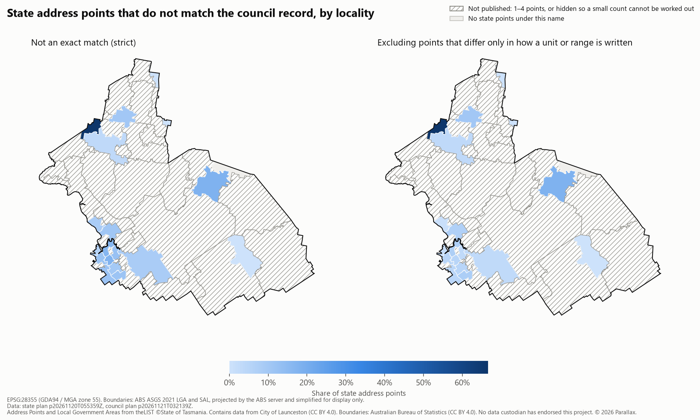

# Parallax

 

The State's and the City of Launceston's public address records, reconciled for the teams who join them: 88% agree exactly, and every difference is named.

<table>
<tr>
<td align="center"> <b>Product film</b> · 0:54</td>
<td align="center"> <b>Poster</b></td>
<td align="center"> <b>Report</b></td>
</tr>
</table>

**What you can check**

- **Pairing is a yes-or-no test.** A state address point is paired with a council parcel only when the parcel covers it: no tolerance, no nearest guess. → [report, Scope](docs/report/RECONCILIATION_REPORT.md#scope)
- **Every difference has a name.** Seven categories, applied to both sides and counted for each. → [categories table](docs/report/data/categories.csv)
- **No state record is published.** The public tables are counts, no finer than street level; counts of 1–4 show as "<5". → [the five public tables](docs/report/data/)
- **It says where it might be wrong.** → [report, "Where I might be wrong"](docs/report/RECONCILIATION_REPORT.md#where-i-might-be-wrong)

Independent project on real open data, published as aggregates; source, method details and a code walkthrough on request ([LinkedIn](https://www.linkedin.com/in/evan-h-165976301/)). → [Status, data and terms](#status-data-and-terms)

## The problem

In Tasmania, councils give properties their addresses and pass them to the State, which publishes them on theLIST and feeds the national address file. Both publish their own version, openly. Nobody publishes how far the two agree.

Anyone who joins the two — for a service area, a mail-out, an emergency map — finds out the hard way, one mismatched address at a time. Parallax measures it once, for a whole municipality, and sorts what it finds.

## Who it is for

| Who | What Parallax gives them |
|---|---|
| Council and state address teams | Where their record and the other side's disagree, by category and by locality |
| Teams that join council and state data | How far the two can be used together, and which differences matter |
| Data quality and governance leads | Which differences look like defects and which are just two ways of writing the same address |

## One example, start to finish

An illustrative address; no real record is shown.

1. **Two records.** The State has a point for *Unit 3, 12 Example Street*. The council has one parcel for *12 Example Street*.
2. **Paired by place.** The point falls inside the parcel, so the two are compared. Property numbers can't link them: the two systems' numbers never match.
3. **Compared field by field.** Street and locality agree; the unit does not. The State lists each unit, the council draws one parcel for the building.
4. **Named.** It goes into the "differs only in how a unit is written" group — most likely not an error on either side.
5. **Checked by a person.** It joins a review class with its look-alikes; a person reads a fixed sample and approves or rewrites the class.
6. **Counted.** It adds one to its locality's count. If that count is 1–4, the public table shows "<5".

## How it is kept honest

- **Neither side is the truth.** Both records may be wrong; the report says what that means for each category.
- **No guessing in the main check.** A point is paired only if a parcel covers it.
- **Nothing leaves without passing the publish gate.** No state record values, nothing finer than street level, small counts hidden.
- **No model decides anything.** Every judgement is drafted by fixed rules and waits for a person.

## What it found

Inside the Launceston municipality, 36,578 state address points:

| | Points | Share |
|---|---:|---:|
| Match the council parcel exactly | 32,358 | 88.46% |
| Differ only in how a unit or number range is written | 2,620 | 7.16% |
| Really differ | 1,600 | 4.37% |

- **Location is the only link.** In 32,358 exact matches, the council's property number never equals the State's.
- **Council parcels overlap.** At least 1,358 overlap another; most look like units drawn over the same land.
- **House numbers differ for 1,194 points**, streets for 572, localities for 127. Which side is right is not known.

The full numbers, maps and limits are in the [public report](docs/report/RECONCILIATION_REPORT.md) ([简体中文](docs/report/RECONCILIATION_REPORT.zh-CN.md)).

## What works today

- **Working:** the full run for Launceston — extraction, pairing, the seven categories, the review queue, and the public report, tables and maps. 609 automated tests, and each stage independently reviewed before it was accepted.
- **Not finished:** a person has yet to approve the review queue class by class; checking the State's own placement rules (S4); a data dictionary and a zoomable map (S5).

## Want to see more?

The source code, the pairing and category rules in full, the decision records, the tests and a code walkthrough on a call are not published here. [Message me on LinkedIn](https://www.linkedin.com/in/evan-h-165976301/).

Methods borrowed with thanks from G-NAF's processing description, `vicmap2osm`, the ABS Data Quality Framework and `publicdata.au`.

## Status, data and terms

Stage S3 (reconciliation engine and report) complete. An independent portfolio project: not an official product of Land Tasmania, the Department of Natural Resources and Environment Tasmania, the City of Launceston or the Australian Bureau of Statistics, and **no data custodian has endorsed it**.

| Source | Licence | Used here |
|---|---|---|
| City of Launceston `Address` (property polygons) | CC BY 4.0, "City of Launceston" | Counts derived from it |
| LIST Address Points and Local Government Areas, ©State of Tasmania | CC BY 3.0 AU badge in the layers' copyright text; whether it is a licence grant is under review | Aggregates only |
| ABS ASGS Edition 3 (2021) LGA and Suburbs and Localities | CC BY 4.0 | Map boundaries |

No individual address, coordinate or identifier from either source appears in this repository. The film has its own [terms and credits](https://zeeekrom.github.io/parallax-showcase/film/terms.html).

© 2026 Parallax. All rights reserved; see [LICENSE](LICENSE). Without written permission, nothing in this repository may be copied, republished or adapted, and the project's code and design may not be rebuilt, whether by hand, with automated tools or with AI cloning tools. The content may not be scraped, bulk-downloaded or used to train or evaluate AI models. Uses the law already allows, such as fair dealing for review or news reporting, are not affected. Sharing links is welcome. The public data credited above keeps its own licence.
