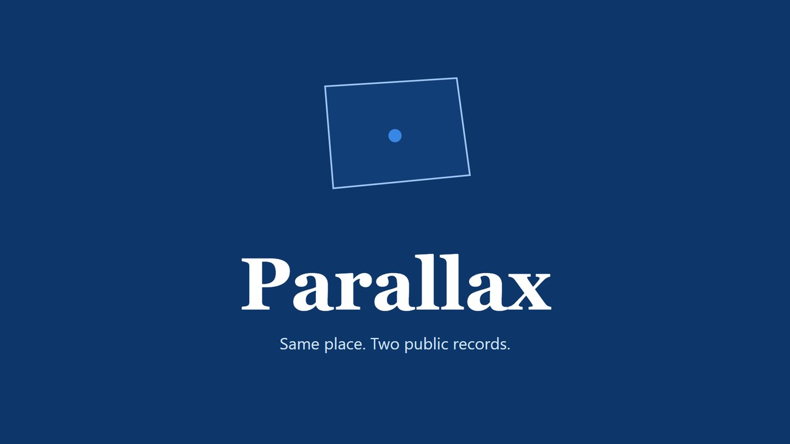
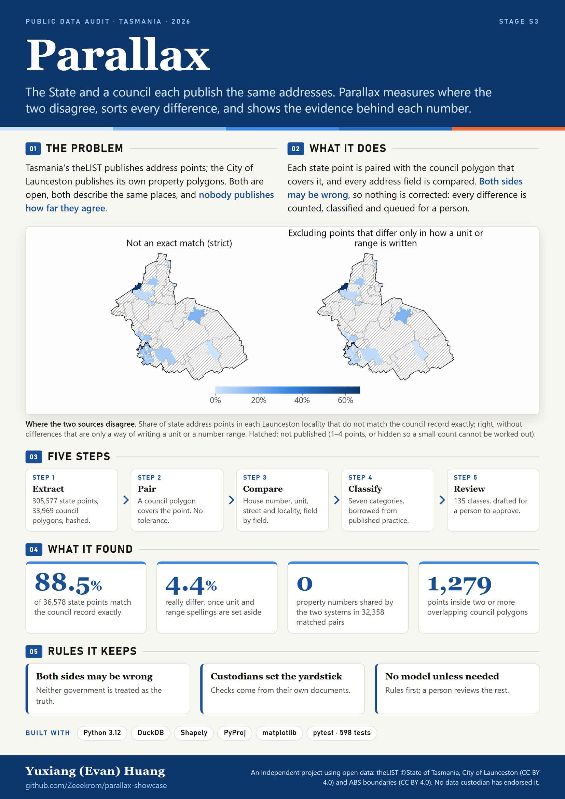
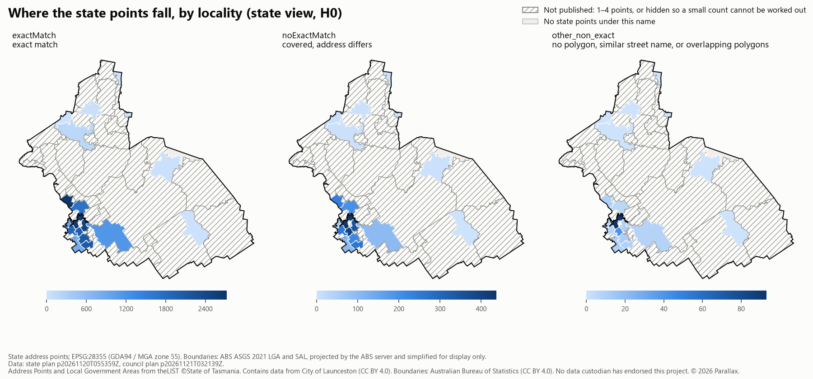
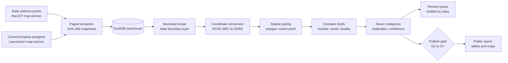

# Parallax

 

State and council address records for Launceston, Tasmania, reconciled: every point paired, every difference named, neither side assumed right.

<table>
<tr>
<td align="center"> <b>Product film</b> · 0:54</td>
<td align="center"> <b>Poster</b></td>
</tr>
</table>

**What you can check**

- **Pairing is a yes-or-no test.** A state point belongs to a council polygon only when the polygon covers it: no tolerance, no buffer, no nearest guess. → [report, Scope](docs/report/RECONCILIATION_REPORT.md#scope)
- **Every difference gets one of seven named categories.** They are borrowed from `vicmap2osm` with its import direction removed, so each applies to both sides, and are counted for state points and council polygons alike. → [categories table](docs/report/data/categories.csv)
- **State records leave only as aggregates.** Every public table passed a publish gate: no state record values, nothing finer than street level, counts of 1–4 shown as "<5", and cells that would let one be worked out shown as "n.p.". → [the five public tables](docs/report/data/)
- **Tested and independently checked.** 609 automated tests; each stage closes with independent fact, rules and code reviews, mutation testing and a rerun from the written commands. → [verification](#verification)

Showcase only: real open data, published as aggregates; source private, with the code and a code walkthrough available on request ([LinkedIn](https://www.linkedin.com/in/evan-h-165976301/)). → [Source, copyright and terms](#source-copyright-and-terms)

## Contents

- [At a glance](#at-a-glance)
- [The question](#the-question)
- [What it found](#what-it-found)
- [How it works](#how-it-works)
- [The seven categories](#the-seven-categories)
- [Borrowed, not invented](#borrowed-not-invented)
- [Rules the project keeps](#rules-the-project-keeps)
- [Verification](#verification)
- [Data, licences and what is published](#data-licences-and-what-is-published)
- [What is not finished](#what-is-not-finished)
- [Files in this repository](#files-in-this-repository)
- [Source, copyright and terms](#source-copyright-and-terms)

## At a glance

| | |
|---|---|
| What it is | An audit of two real, independently published public datasets: a reconciliation engine, a review queue, a defect register, a quality statement and maps, all generated by code |
| Who it is for | Data quality, spatial data and records teams in local and state government, and anyone who joins council and state address data |
| The question | When the State and a council each publish a record of the same property, can the two be used together? Where do they disagree, by how much, in which category, and what does that mean for a user? |
| Data | 305,577 LIST Address Points (state) and 33,969 City of Launceston property polygons (council), taken through their public map services in 2,000-record pages with SHA-256 snapshots |
| Scope | The Launceston municipality: 36,578 state address points |
| Method | Spatial pairing with no tolerance, address scrubbing, field-by-field comparison, seven categories, three kinds of duplicate, a G-NAF-style confidence level and a class-by-class review queue, all borrowed from published Australian practice |
| AI | None in the pipeline. A ranking model was allowed if the residual were too large for a person to review; the design expects not to need one, which is confirmed once a person has approved the review classes |
| Stack | Python 3.12, DuckDB, Shapely, PyProj, pytest, matplotlib |
| Evidence | 609 automated tests; every stage checked by independent reviewers (facts, rules, code, mutation testing) and rerun from the written commands by a separate reproducer |
| Status | Stage S3 (reconciliation engine and report) complete and accepted on 22 November 2026; the review queue is drafted and still to be approved class by class. Stages S4–S7 are planned |

## The question

In Tasmania, councils allocate property addresses and report them to the State, which publishes them through theLIST
and passes them on to the national address file. Both governments publish their version openly. Nobody publishes how
far the two versions agree.

Parallax does not need the data to be bad to be useful. High agreement is also a result, and a more useful one: "the
two can be used together, and the small part that disagrees falls into these categories". The only real failure would
be two sources that do not describe the same things. They do: in S2, 99.73% of the state points inside the
municipality fell inside a council polygon.

The name comes from surveying and astronomy: when the same object is seen from two positions, the shift between
the two views is not noise; it is the measurement. Parallax does not assume either side is the true position.
**Both sides may be wrong.**

## What it found

Inside the Launceston municipality (state view, documented datum):

| | State address points | Share |
|---|---:|---:|
| Exact match with the council polygon that covers them (number, unit, street and locality) | 32,358 | 88.46% |
| Not an exact match | 4,220 | 11.54% |
| ... of which only a unit or range is written differently | 2,620 | 7.16% |
| ... real differences left | 1,600 | 4.37% |

- **Property numbers do not link the two systems.** In 32,358 exactly matched pairs, the council `Property_no` never
  equals the state `PID`. Location is the only reliable link.
- **Most disagreement is representation, not error.** The State gives each unit its own point; the council often
  draws one polygon for the whole property, or writes a number range such as 2–6.
- **Council polygons overlap.** 1,279 state points sit inside two or more council polygons, and at least 1,358 council
  polygons overlap another one (counted where a state point lies in the overlap). 1,064 of those share their base address with other polygons and differ only by unit number, which
  suggests strata units drawn over the same land; whether that is intended is for a person to decide.
- **Some records have no counterpart.** 99 state points are not covered by any council polygon; 424 council polygons
  contain no state point.
- **House numbers differ for 1,194 points** after allowing for units and ranges; street names differ for 572 and
  localities for 127. Which side is right is not known.
- **The datum matters at the edges.** Under the alternative GDA2020 assumption, 95 points change category.

Share of state address points in each Launceston locality that do not match the council record exactly. Left: every
difference. Right: without differences that are only a different way of writing a unit or a number range. Hatched
localities are not published: they have a count from 1 to 4, or are hidden so that such a count cannot be worked out
from the totals. Most urban localities are shown; most rural ones are hatched.

The full public report, with every table and the section "Where I might be wrong", is in
[`docs/report/RECONCILIATION_REPORT.md`](docs/report/RECONCILIATION_REPORT.md).

## How it works

1. **Extract.** Both map services return at most 2,000 records per request. Extraction runs in batches by locality,
   resumes after interruption and checks that the batches add up to the total.
2. **Scope.** The state layer has no council field, so points are placed in the municipality by a spatial join with
   the state's own municipal boundaries.
3. **Convert.** State points arrive in Web Mercator, council polygons in MGA zone 55. The datum is taken from the
   custodian's documentation (GDA94); GDA2020 is run as a sensitivity case.
4. **Pair.** A point belongs to a council polygon when the polygon covers it. There is no tolerance, buffer or
   nearest-neighbour search: a point that no polygon covers has no counterpart.
5. **Compare.** Addresses are scrubbed only as far as needed: case, spaces, empty values; council house numbers split
   into unit, first and last number and suffixes; council street names split with the State's own vocabulary.
6. **Classify.** Each point and each polygon gets one of seven categories, with reason codes and flags.
7. **Review.** Every state point that is not a plain exact match, and every council polygon with no counterpart or with
   a flag (overlap, duplicate), goes into a review queue: 11,586 records in 135 classes. Each
   class is drafted from a fixed template; a person approves or rewrites a class after a fixed-seed sample of up to 10.
8. **Publish.** Public tables pass a gate: no state record values, nothing finer than street level, counts of 1–4
   shown as "<5", cells hidden so that a small count cannot be worked out shown as "n.p." (across tables), and
   attribution for every source.

## The seven categories

| Category | Where it comes from | State points | Council polygons |
|---|---|---:|---:|
| `outsideScope` | Added by this project (the comparison frame) | 268,999 | 0 |
| `noCounterpart` | `vicmap2osm`, two categories merged once the import direction is removed | 99 | 424 |
| `exactMatch` | `vicmap2osm` | 32,358 | 32,363 |
| `fuzzyStreetMatchSingle` | `vicmap2osm` | 40 | 40 |
| `fuzzyStreetMatchMultiple` | `vicmap2osm` | 0 | 0 |
| `withinOverlappingPolygons` | Added by this project | 107 | 0 |
| `noExactMatch` | `vicmap2osm`, with reason codes; the two representation rules are this project's own | 3,974 | 1,142 |

`vicmap2osm` sorts Victorian addresses for import into OpenStreetMap, so its categories point one way. Parallax
removes that direction: every category applies to both sides, and for each one the report says what "both sides may
be wrong" means.

## Borrowed, not invented

| From | What Parallax uses |
|---|---|
| G-NAF (Geoscape's national address file) processing description | The stages (scrubbing, locality and street validation, merging; the two geocoding stages do not apply) and the confidence level: number of sources minus one |
| `vicmap2osm` (an open-source Victorian address conflation) | The seven categories and their order, the exact-match fields, the street-name similarity rule (lcs above 0.8) and the three kinds of duplicate |
| ABS Data Quality Framework | The seven quality dimensions used in the quality statement and the defect register |
| `publicdata.au` | Immutable source snapshots with hashes, and the line "has not endorsed this site" |

Each borrowing is checked against its original text, and the private repository records which parts were read in
full and which only from a summary.

## Rules the project keeps

- **Both sides may be wrong.** Neither the State nor the council is treated as the truth.
- **The main check is a yes-or-no test.** A fallback with a threshold needs a written reason and a review queue.
- **The yardstick is the custodian's own documentation**, not a number the project made up.
- **State records are published only as aggregates**, no finer than street level, and small counts are suppressed.
- **No model unless the residual demands one.** Deterministic rules first, then fuzzy matching, then a model only if a
  person cannot review what is left. Here a person can.
- **Free-text fields are never fed to a model**, and any future AI use is risk-assessed before it is adopted.

## Verification

- 609 automated tests, including tests designed from the requirements by an agent that never saw the code.
- Every stage closes with independent reviews: a fact checker, a rules reviewer, a code reviewer and mutation testing
  (deliberate faults planted in the code to see whether the tests catch them).
- A separate reproducer reruns each stage from the written commands in a clean copy and checks the numbers. The S2
  rerun reproduced every figure.
- Every public table passed the publish gate; the public report and maps are generated only from those tables.
- S3's closing review ran two rounds. Among other things it found a suppression marker that made large counts look
  small, small counts that could be worked out by subtracting one public table from another, and a miscounted overlap
  figure. All were fixed and tested before S3 was accepted.

## Data, licences and what is published

| Source | Licence | Published here |
|---|---|---|
| City of Launceston `Address` (property polygons) | CC BY 4.0, "City of Launceston"; no extra terms found on the council's portal (checked 22 November 2026) | Counts derived from it |
| LIST Address Points and Local Government Areas, ©State of Tasmania | The layers' copyright text carries a CC BY 3.0 AU badge; whether that is a licence grant is under review | Aggregates only: counts and rates, no finer than street level |
| ABS ASGS Edition 3 (2021) LGA and Suburbs and Localities | CC BY 4.0 | Map boundaries, for display |

No individual address, coordinate or identifier from either source appears in this repository.

## What is not finished

- The review queue is drafted but not yet approved class by class.
- S4: checking the State's own placement rules and self-reported accuracy against the results.
- S5: data dictionary, lineage and a zoomable web map.
- S6 and S7: an AI risk assessment, then a read-only drafting assistant over the structured results.

## Files in this repository

| Path | What it is |
|---|---|
| [`docs/report/RECONCILIATION_REPORT.md`](docs/report/RECONCILIATION_REPORT.md) | Public reconciliation report ([简体中文](docs/report/RECONCILIATION_REPORT.zh-CN.md)) |
| [`docs/report/data/`](docs/report/data/) | The five public tables that passed the publish gate, each with its attribution file |
| [`docs/report/maps/`](docs/report/maps/) | The two maps, in English and Chinese, and the poster-size map panels |
| [`docs/poster.jpg`](docs/poster.jpg) | One-page poster ([简体中文](docs/poster.zh.jpg)) |
| [`film/`](https://zeeekrom.github.io/parallax-showcase/film/) | Product film page; the film is 54 seconds, 1920×1080: the two sources, the yes-or-no pairing, the field-by-field comparison, the seven categories with their real counts, the public map and the rules the project keeps. English on-screen text, no narration; the music is synthesised in code and every number comes from the public tables |

## Source, copyright and terms

The source code, tests, raw extracts and review queue live in a private repository. The code and a walkthrough of it
are available on request: [message me on LinkedIn](https://www.linkedin.com/in/evan-h-165976301/). This repository is a curated
showcase: the public report, the public tables that passed the project's publish gate, the maps, and the poster and
product film.

The film has its own [terms, licences and privacy page](https://zeeekrom.github.io/parallax-showcase/film/terms.html), which lists its third-party credits (sound
effects, fonts, data).

© 2026 Parallax. All rights reserved; see [LICENSE](LICENSE). Without written permission, nothing in this repository
may be copied, republished or adapted, and the project's code and design may not be rebuilt, whether by hand, with
automated tools or with AI cloning tools. The content may not be scraped, bulk-downloaded or used to train or evaluate
AI models. Uses the law already allows, such as fair dealing for review or news reporting, are not affected. Sharing
links is welcome. The public data credited above keeps its own licence.

This is an independent portfolio project. It is not an official product of Land Tasmania, the Department of Natural
Resources and Environment Tasmania, the City of Launceston or the Australian Bureau of Statistics, and **no data
custodian has endorsed it**. It works only with data those custodians publish openly.
