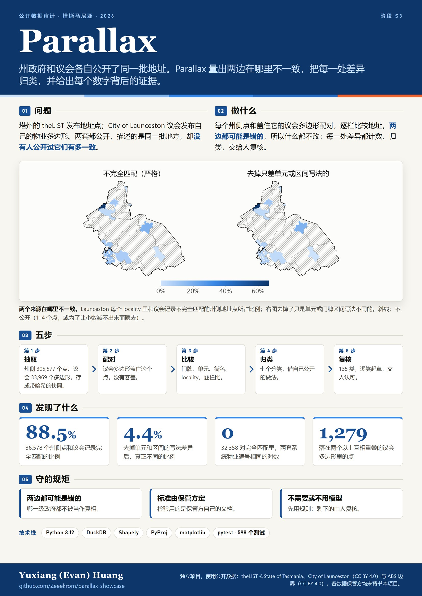

# Parallax

 

> 这是英文版 README 的中文译本，以英文版为准。

把塔州州政府和 City of Launceston 议会各自公开的地址记录逐条对账，给要把两边拼起来用的团队看：88% 完全一致，每一处不同都有名字。

<table>
<tr>
<td align="center"> <b>产品介绍视频</b> · 0:54</td>
<td align="center"> <b>海报</b></td>
<td align="center"> <b>报告</b></td>
</tr>
</table>

**能看到什么**

- **配对是"是或否"的判断。** 议会地块盖住一个州侧地址点，两者才配成一对：没有容差，不找最近的。→ [报告"范围"一节](docs/report/RECONCILIATION_REPORT.zh-CN.md#范围)
- **每一处不同都有名字。** 七个分类，对两边都适用，两边各自计数。→ [分类表](docs/report/data/categories.csv)
- **州侧记录一条都不公开。** 公开表只有计数，最细到街道一级；1–4 的计数写"<5"。→ [五张公开表](docs/report/data/)
- **它写明了自己可能错在哪。** → [报告"我可能错在哪"一节](docs/report/RECONCILIATION_REPORT.zh-CN.md#我可能错在哪)

独立项目，用真实公开数据，只发聚合；源码、方法细节和代码导览可约看：[领英私信我](https://www.linkedin.com/in/evan-h-165976301/)，或发邮件到 [yuxianghuang2026@gmail.com](mailto:yuxianghuang2026@gmail.com)。→ [状态、数据与条款](#状态数据与条款)

## 问题在哪

在塔州，议会给物业编地址、报给州政府，州政府在 theLIST 上发布，再转给全国地址库。两边都公开了自己那一版，没有人公开过两版有多一致。

要把两边拼起来用的人——划服务范围、寄信、做应急地图——只能一个个撞上对不上的地址。Parallax 把一个辖区一次量清楚，并把发现的不同分门别类。

## 给谁用

| 谁 | Parallax 给他们什么 |
|---|---|
| 议会和州政府的地址团队 | 自己的记录和对面在哪里不一致，按分类、按 locality 列出 |
| 要把议会和州数据拼起来用的团队 | 两边能不能一起用，哪些不同要紧 |
| 数据质量和治理负责人 | 哪些不同像是缺陷，哪些只是同一个地址的两种写法 |

## 一个例子，从头到尾

地址是示意用的，不展示任何真实记录。

1. **两条记录。** 州侧有一个点，地址是 *12 Example Street 的 3 号单元*；议会有一块地，地址是 *12 Example Street*。
2. **按位置配对。** 这个点落在这块地里，两条记录就拿来比。物业编号连不起来：两套系统的编号从来对不上。
3. **逐栏比较。** 街名和 locality 一样，单元不一样：州侧给每个单元一个点，议会给整栋楼画一块地。
4. **归类。** 它归进"只是单元的写法不同"这一组——多半两边都没错。
5. **人来看。** 它和同类的记录放在一个复核类里；人看过固定抽出的几条后，认可或改写这一类。
6. **计数。** 它给所在 locality 的计数加一。这个计数是 1–4 时，公开表里写"<5"。

## 怎么保证靠谱

- **哪一边都不当真相。** 两边都可能错；报告逐类写明这在每一类里意味着什么。
- **主检查不靠猜。** 只有地块盖住了点，才配成一对。
- **没过发布闸门的不出去。** 不含州侧记录的值，最细到街道一级，小数隐去。
- **没有模型替人做决定。** 每一条判断都由固定规则起草，等人来定。

## 发现了什么

Launceston 辖区内，36,578 个州侧地址点：

| | 点数 | 比例 |
|---|---:|---:|
| 和议会地块完全一致 | 32,358 | 88.46% |
| 只是单元或门牌区间的写法不同 | 2,620 | 7.16% |
| 真的不同 | 1,600 | 4.37% |

- **位置是唯一的连接。** 32,358 对完全一致的记录里，议会的物业编号和州侧的一次都不相等。
- **议会地块会重叠。** 至少 1,358 块和别的重叠，大多像是同一块地上画的分层单元。
- **门牌不同的有 1,194 个点**，街名不同 572 个，locality 不同 127 个。哪一边对不知道。

完整的数字、地图和局限在[公开版报告](docs/report/RECONCILIATION_REPORT.zh-CN.md)里（[English](docs/report/RECONCILIATION_REPORT.md)）。

## 现在能做什么

- **能做的：** Launceston 整个跑通——抽取、配对、七分类、复核队列，以及公开版报告、表格和地图。609 个自动化测试；每个阶段都经过独立审查，人接受后才算完成。
- **还没做完的：** 复核队列还要人按类批完；用州侧自己的放置规则检验结果（S4）；数据字典和能缩放的地图（S5）。

## 想看更多？

源码、完整的配对和分类规则、决策记录、测试，以及通话里的代码导览都不在这里公开，可约看：[领英私信我](https://www.linkedin.com/in/evan-h-165976301/)，或发邮件到 [yuxianghuang2026@gmail.com](mailto:yuxianghuang2026@gmail.com)。

方法借自 G-NAF 的处理说明、`vicmap2osm`、ABS 数据质量框架和 `publicdata.au`，在此致谢。

## 状态、数据与条款

S3（对账引擎与报告）已完成。这是一个独立的作品集项目，不是 Land Tasmania、塔州自然资源与环境部、City of Launceston 或澳大利亚统计局（ABS）的官方产品，**各数据保管方均未背书本项目**。

| 来源 | 许可 | 这里怎么用 |
|---|---|---|
| City of Launceston `Address`（物业多边形） | CC BY 4.0，署名 "City of Launceston" | 由它算出的计数 |
| LIST Address Points 与 Local Government Areas，©State of Tasmania | 图层的版权文字里有 CC BY 3.0 AU 徽章；它算不算授予许可还在审定 | 只有聚合 |
| ABS ASGS 第 3 版（2021）的 LGA 与 Suburbs and Localities | CC BY 4.0 | 地图边界 |

这个仓库里没有任何一侧的任何一条地址、坐标或标识。视频有自己的[条款与署名页](https://zeeekrom.github.io/parallax-showcase/film/terms.zh-CN.html)。

© 2026 Parallax，保留所有权利；见 [LICENSE](LICENSE)。未经书面许可，不得复制、转载或改编本仓库的任何内容，也不得重建项目自己的代码和设计（手工、自动化工具、克隆网站或代码的 AI 工具都算）。不得抓取、批量下载本仓库的内容，或拿去训练、评估 AI 模型。著作权法本身允许的使用（例如为评论、新闻报道合理引用）不受影响。欢迎分享链接。上面列出的公开数据保留各自的许可。
