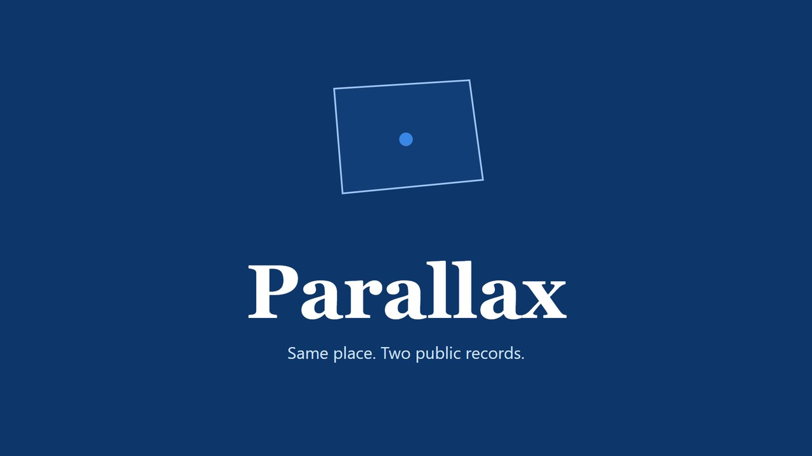
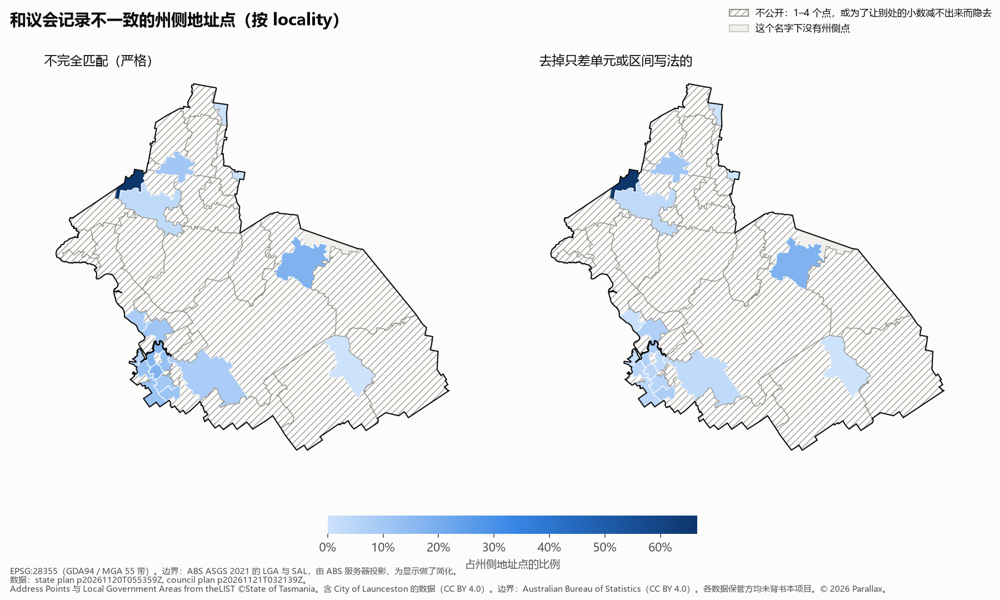
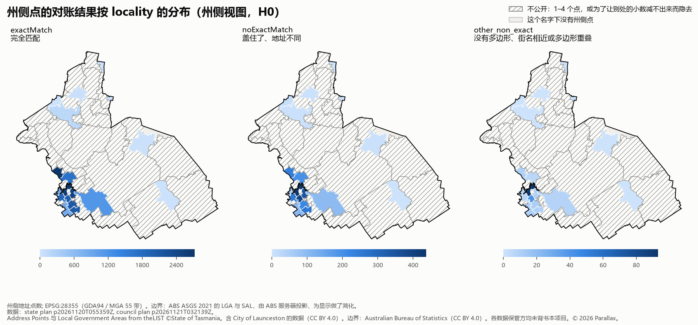
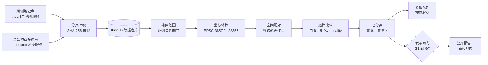

# Parallax

 

> 这是英文版 README 的中文译本，以英文版为准。

塔州 Launceston 的州侧与议会地址记录逐条对账：每个点都配上对，每处不同都有名字，不假定哪一边是对的。

<table>
<tr>
<td align="center"> <b>产品介绍视频</b> · 0:54</td>
<td align="center"> <b>海报</b></td>
</tr>
</table>

**能看到什么**

- **配对是"是或否"的判断。** 议会多边形盖住一个州侧点，这个点才属于它：没有容差、不用缓冲、不找最近的。→ [报告"范围"一节](docs/report/RECONCILIATION_REPORT.zh-CN.md#范围)
- **每处不同都归进七个有名字的分类之一。** 分类借自 `vicmap2osm`，去掉了导入方向，所以每一类对两边都适用，州侧点和议会多边形各自计数。→ [分类表](docs/report/data/categories.csv)
- **州侧记录只以聚合的形式出来。** 每张公开表都过了发布闸门：不含州侧记录的值、最细到街道一级、1–4 的计数写"<5"、能让小数被算出来的格子写"n.p."。→ [五张公开表](docs/report/data/)
- **有测试，有独立检查。** 609 个自动化测试；每个阶段收尾都做独立的事实、规则、代码审查和变异测试，并照写下的命令从头重跑。→ [怎么验证的](#怎么验证的)

展示版：真实公开数据，只发聚合；源码不公开，源码和代码导览可约看（[领英](https://www.linkedin.com/in/evan-h-165976301/)）。→ [源码、版权与条款](#源码版权与条款)

## 目录

- [一览](#一览)
- [要回答的问题](#要回答的问题)
- [发现了什么](#发现了什么)
- [怎么做的](#怎么做的)
- [七分类](#七分类)
- [方法是借来的](#方法是借来的)
- [项目守的规矩](#项目守的规矩)
- [怎么验证的](#怎么验证的)
- [数据、许可与公开了什么](#数据许可与公开了什么)
- [还没做完的](#还没做完的)
- [仓库里的文件](#仓库里的文件)
- [源码、版权与条款](#源码版权与条款)

## 一览

| | |
|---|---|
| 是什么 | 对两套真实、各自独立发布的公开数据做审计：对账引擎、复核队列、缺陷登记册、质量声明和地图，全部由代码生成 |
| 给谁用 | 地方和州政府里做数据质量、空间数据、档案的团队，以及任何要把议会和州的地址数据拼起来用的人 |
| 问题 | 州和议会各自发布了同一处物业的记录时，两边能不能一起用？在哪里不一致、差多少、属于哪一类、对使用者意味着什么？ |
| 数据 | 州侧 LIST Address Points 305,577 条、City of Launceston 物业多边形 33,969 个，经各自的公开地图服务按每页 2,000 条取得，存成带 SHA-256 的快照 |
| 范围 | Launceston 辖区：36,578 个州侧地址点 |
| 方法 | 无容差的空间配对、地址清洗、逐栏比较、七分类、三种重复、G-NAF 式的置信度、按类批的复核队列——都借自澳洲已公开的做法 |
| AI | 流程里没有。计划允许在残差多到人看不完时训练一个排序模型；设计预计用不着，要等人把复核的各类批完才算确认 |
| 技术栈 | Python 3.12、DuckDB、Shapely、PyProj、pytest、matplotlib |
| 证据 | 609 个自动化测试；每个阶段都由独立的检查方审过（事实、规则、代码、变异测试），并由另一个复现方照写下的命令从头重跑 |
| 状态 | S3（对账引擎与报告）已完成，2026 年 11 月 22 日由人接受；复核队列已经起草，还要按类批。S4–S7 在计划中 |

## 要回答的问题

在塔州，议会给物业分配地址、报给州政府，州政府通过 theLIST 发布，再转给全国地址库。两级政府都公开了自己那一版。没有人公开过两版有多一致。

Parallax 不需要数据很糟才有用。高度一致同样是结论，而且更有用："两边可以一起用，不一致的那一小部分落在这几类里"。
真正的失败只有一种：两个来源描述的根本不是同一批东西。事实上是同一批：S2 里，辖区内 99.73% 的州侧点落在议会多边形里。

名字来自测绘和天文：同一个物体从两个位置看过去，两次观察之间的位移不是噪声，正是测量本身。Parallax 不假定哪一边是"正确位置"。
**两边都可能是错的。**

## 发现了什么

Launceston 辖区内（州侧视图，按文档定的基准）：

| | 州侧地址点 | 比例 |
|---|---:|---:|
| 和盖住它的议会多边形完全匹配（门牌、单元、街名、locality） | 32,358 | 88.46% |
| 不完全匹配 | 4,220 | 11.54% |
| ……其中只是单元或区间写法不同 | 2,620 | 7.16% |
| ……剩下真正不同的 | 1,600 | 4.37% |

- **物业编号连不起两套系统。** 32,358 对完全匹配里，议会的 `Property_no` 和州侧的 `PID` 一次都不相等。位置是唯一可靠的连接。
- **大部分不一致是写法，不是错误。** 州侧给每个单元一个点；议会常常给整个物业画一个多边形，或者写成 2–6 这样的门牌区间。
- **议会多边形会重叠。** 1,279 个州侧点落在两个以上议会多边形里，至少 1,358 个议会多边形和别的多边形重叠（只数得到重叠处有州侧点的）。其中 1,064 个和别的多边形基本地址相同、只差单元号，像是分层物业的单元画在同一块地上；这是不是有意的，由人来判断。
- **有的记录在对面找不到。** 99 个州侧点不在任何议会多边形里；424 个议会多边形里没有州侧点。
- **门牌号不同的有 1,194 个点**（已排除单元和区间写法），街名不同 572 个，locality 不同 127 个。哪一边对不知道。
- **基准在边缘上有影响。** 换成 GDA2020 的假设，有 95 个点换了分类。

Launceston 每个 locality 里，和议会记录不完全匹配的州侧地址点所占的比例。左：所有不同。右：去掉只是单元或门牌区间写法不同的。
画斜线的 locality 不公开：它们有 1–4 的计数，或者为了让这样的计数不能用合计减出来而一起隐去。城区大多显示，农村大多画斜线。

完整的公开版报告，包括每一张表和"我可能错在哪"一节，在 [`docs/report/RECONCILIATION_REPORT.zh-CN.md`](docs/report/RECONCILIATION_REPORT.zh-CN.md)。

## 怎么做的

1. **抽取。** 两边的地图服务每次最多给 2,000 条。按 locality 分批抽取，中断后能续跑，并核对各批之和等于总数。
2. **范围。** 州侧图层没有议会字段，所以用州自己的辖区边界做空间连接，把点归进辖区。
3. **转换。** 州侧点是 Web Mercator，议会多边形是 MGA 55 带。基准按保管方的文档取 GDA94；GDA2020 作为敏感性情形另算一遍。
4. **配对。** 议会多边形盖住一个点，这个点就属于它。没有容差、不用缓冲、不找最近的：没有多边形盖住的点就是没有对应。
5. **比较。** 地址只清洗到够用为止：大小写、空白、空值；议会门牌拆成单元、起止号和后缀；议会街名用州侧自己的词表拆。
6. **分类。** 每个点、每个多边形各归七类之一，带原因代码和标记。
7. **复核。** 凡不是简单完全匹配的州侧点，以及没有对应或带标记（重叠、重复）的议会多边形，都进复核队列：11,586 条、135 类。每类用固定模板起草；人看过固定种子抽出的最多 10 条后，按类认可或改写。
8. **发布。** 公开表要过闸门：不含州侧记录的值、最细到街道一级、1–4 的计数写"<5"，为了让小数减不出来而隐去的格子写"n.p."（跨表一起隐去），每个来源都有署名。

## 七分类

| 分类 | 出处 | 州侧点 | 议会多边形 |
|---|---|---:|---:|
| `outsideScope` | 本项目加的（比对框） | 268,999 | 0 |
| `noCounterpart` | `vicmap2osm`，去掉导入方向后两类合成一类 | 99 | 424 |
| `exactMatch` | `vicmap2osm` | 32,358 | 32,363 |
| `fuzzyStreetMatchSingle` | `vicmap2osm` | 40 | 40 |
| `fuzzyStreetMatchMultiple` | `vicmap2osm` | 0 | 0 |
| `withinOverlappingPolygons` | 本项目加的 | 107 | 0 |
| `noExactMatch` | `vicmap2osm`，带原因代码；两条写法差异规则是本项目自己的 | 3,974 | 1,142 |

`vicmap2osm` 是把维州地址导入 OpenStreetMap 时用的分类，所以它的分类有方向。Parallax 去掉了方向：每一类对两边都适用，
报告里逐类写明"两边都可能是错的"在这一类里是什么意思。

## 方法是借来的

| 来自 | Parallax 用了什么 |
|---|---|
| G-NAF（Geoscape 的全国地址库）的处理说明 | 处理阶段（清洗、locality 与街道校验、合并；两个 geocoding 阶段不适用）和置信度：来源数减一 |
| `vicmap2osm`（维州地址合并的开源项目） | 七分类及其判定顺序、完全匹配比哪几栏、街名相似度规则（lcs 大于 0.8）、三种重复 |
| ABS 数据质量框架 | 质量声明和缺陷登记册用的七个质量维度 |
| `publicdata.au` | 带哈希的不可变源快照，以及"has not endorsed this site"这句声明 |

每一处借用都对照过原文；私密仓库里记着哪些读过全文、哪些只读过摘要。

## 项目守的规矩

- **两边都可能是错的。** 州和议会都不被当作真相。
- **主检查是"是或否"的判断。** 带阈值的后备手段要有书面理由和复核队列。
- **检验标准用保管方自己的文档**，不用项目自己编的数字。
- **州侧记录只发聚合**，最细到街道一级，小格子隐去。
- **残差不需要就不上模型。** 先确定性规则，再模糊匹配，人看不完剩下的才考虑模型。这里人看得完。
- **自由文本字段永远不喂给模型**，以后任何 AI 用途都先做风险评估再采用。

## 怎么验证的

- 609 个自动化测试，其中有一部分是由一个从没看过代码的智能体按需求设计的。
- 每个阶段收尾都做独立审查：事实核对、规则审查、代码审查和变异测试（故意在代码里埋错，看测试抓不抓得到）。
- 另有一个复现方在干净的副本里照写下的命令从头重跑每个阶段、核对数字。S2 的重跑复现了全部数字。
- 每张公开表都过了发布闸门；公开版报告和地图只从这些表生成。
- S3 的收尾审查做了两轮，发现的问题里包括：补充隐去的标记让大数看起来像小数、用一张公开表减另一张能算出小数、一个重叠数算错了。
  都在 S3 被接受之前修好并补了测试。

## 数据、许可与公开了什么

| 来源 | 许可 | 这里公开了什么 |
|---|---|---|
| City of Launceston `Address`（物业多边形） | CC BY 4.0，署名 "City of Launceston"；议会门户上没有附加条件（2026 年 11 月 22 日核对） | 由它算出的计数 |
| LIST Address Points 与 Local Government Areas，©State of Tasmania | 图层的版权文字里有 CC BY 3.0 AU 徽章；它算不算授予许可还在审定 | 只有聚合：计数和比例，最细到街道一级 |
| ABS ASGS 第 3 版（2021）的 LGA 与 Suburbs and Localities | CC BY 4.0 | 地图边界，只用于显示 |

这个仓库里没有任何一侧的任何一条地址、坐标或标识。

## 还没做完的

- 复核队列已经起草，还没有按类批完。
- S4：用州自己的放置规则和自报精度去检验对账结果。
- S5：数据字典、血缘和一张能缩放的网页地图。
- S6 与 S7：先做 AI 风险评估，再做一个只读结构化结果的起草助手。

## 仓库里的文件

| 路径 | 是什么 |
|---|---|
| [`docs/report/RECONCILIATION_REPORT.zh-CN.md`](docs/report/RECONCILIATION_REPORT.zh-CN.md) | 公开版对账报告（[English](docs/report/RECONCILIATION_REPORT.md)） |
| [`docs/report/data/`](docs/report/data/) | 过了发布闸门的五张公开表，每张旁边有署名文件 |
| [`docs/report/maps/`](docs/report/maps/) | 两张地图，各有英文版和中文版，以及海报用的地图 |
| [`docs/poster.zh.jpg`](docs/poster.zh.jpg) | 一页海报（[English](docs/poster.jpg)） |
| [`film/`](https://zeeekrom.github.io/parallax-showcase/film/) | 产品介绍视频的播放页；视频 54 秒，1920×1080：两个来源、"是或否"的配对、逐栏比较、带真实计数的七分类、公开版地图，以及项目守的规矩。画面文字是英文，没有旁白；配乐由代码合成，每个数字都来自公开表 |

## 源码、版权与条款

源码、测试、原始抽取和复核队列都在私密仓库里。源码和代码导览可约看：[在领英上联系我](https://www.linkedin.com/in/evan-h-165976301/)。这个仓库是精选的展示：公开版报告、过了项目发布闸门的公开表、地图，以及海报和产品介绍视频。

视频有自己的[条款、许可与隐私页](https://zeeekrom.github.io/parallax-showcase/film/terms.zh-CN.html)，列出了它用到的第三方内容（音效、字体、数据）。

© 2026 Parallax，保留所有权利；见 [LICENSE](LICENSE)。未经书面许可，不得复制、转载或改编本仓库的任何内容，也不得重建项目自己的代码和设计
（手工、自动化工具、克隆网站或代码的 AI 工具都算）。不得抓取、批量下载本仓库的内容，或拿去训练、评估 AI 模型。
著作权法本身允许的使用（例如为评论、新闻报道合理引用）不受影响。欢迎分享链接。上面列出的公开数据保留各自的许可。

这是一个独立的作品集项目，不是 Land Tasmania、塔州自然资源与环境部、City of Launceston 或澳大利亚统计局（ABS）的官方产品，
**各数据保管方均未背书本项目**。它只用这些保管方公开发布的数据。
