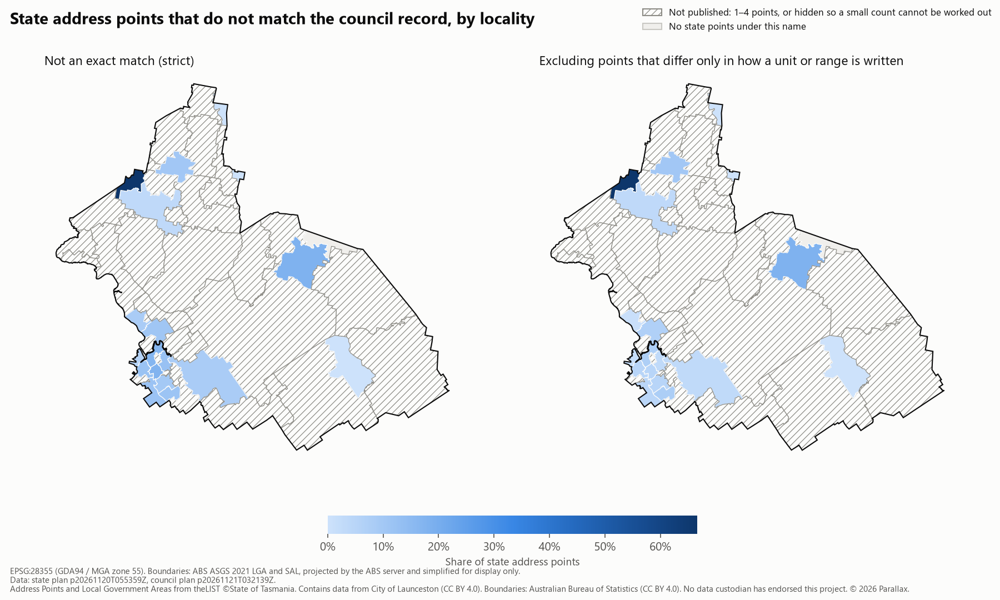
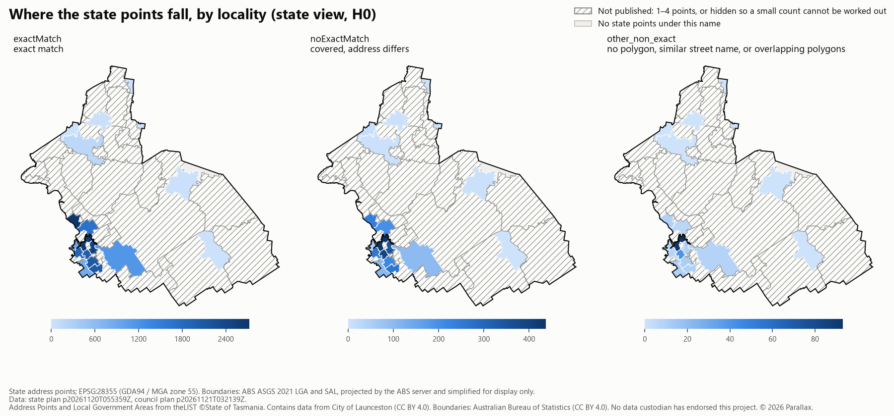

# Reconciliation report: state address points and City of Launceston property addresses

> **Public version.** Generated only from tables that passed the publish gate (`src/publish.py`, rules G1–G7). "<5" means a count from 1 to 4. "n.p." means not published: the value is withheld, whatever it is (0, 1 to 4 or more), so that a small count cannot be worked out by subtraction. No record of either side appears here.
> English is the authoritative version; a Simplified Chinese translation is alongside.
> Data: state LIST Address Points (extraction plan `p20261120T055359Z`), City of Launceston `Address` (plan `p20261121T032139Z`). Run `S3-reconcile-2026-11-22-20261122T044936Z.json`.

## Summary

- Inside the Launceston municipality there are **36,578** state address points and the council publishes **33,969** property polygons.
- **32,358** points (88.46%) match the council polygon that covers them exactly: same number, unit, street and locality.
- **4,220** points (11.54%) do not match exactly. **2,620** of them are covered by a council polygon and differ from it only in how a unit or a number range is written (`noExactMatch`); without those, **1,600** (4.37%) remain.
- **1,279** points sit inside two or more overlapping council polygons.
- Property numbers do not link the two sides: in **32,358** exactly matched pairs, the council `Property_no` equals the state `PID` **0** times. Space is the only anchor.
- Every state point that is not a plain exact match, and every council polygon with no counterpart or with a flag (overlap, duplicate), goes into a review queue: **11,586** records in **135** classes, each drafted from a fixed template. No model is used; approval of the classes by a person is under way.

## Scope

The comparison frame is the Launceston municipality. State points are those S1 placed inside or on the boundary of the municipality (state layer 28), with coordinates converted in S2 to EPSG:28355 under the documented datum (GDA94, H0). All council polygons are used. A point belongs to a polygon when the polygon **covers** it (inside or on the edge): a yes-or-no test with no tolerance, no buffer and no nearest neighbour.

## Method

The stages follow G-NAF's processing description (six stages); four are used, two do not apply and one is added:

| G-NAF stage | This project |
|---|---|
| 1 Address scrubbing | Used: case, whitespace, empty values; house numbers into five fields; council street names split with the state's own vocabulary |
| 2 State-Locality validation and geocoding | First half used (localities compared); geocoding does not apply - both sides already have geometry |
| 3 Street validation | Used: name, type and suffix compared; the only place a fuzzy rule is allowed |
| 4 Street geocoding | Does not apply |
| 5 Address geocoding | Does not apply |
| 6 Merging (criteria, confidence) | Used: the seven categories and the confidence level |
| (no separate G-NAF stage) | Added by this project: house number check, five fields, with the two representation rules |

The seven categories follow `vicmap2osm`'s conflation order with its import direction removed: every category applies to both sides. Two categories are this project's own and are marked as such below. An exact match needs the same number (all five fields, unit and range included), street (name, type, suffix) and locality. A street-name near miss uses `vicmap2osm`'s rule (lcs similarity above 0.8 on the whole street string, from the `string-comparison` package) plus this project's stricter condition that type and suffix are equal; it is never counted as a match.

## The seven categories

Each state point is classified from its own side; each council polygon from the (point, this polygon) pairs it takes part in. Both views use H0.

| Category | State points | Council polygons | Where it comes from | What "both sides may be wrong" means here |
|---|---:|---:|---|---|
| `outsideScope` | 268,999 | 0 | Borrowed from: added by this project (the comparison frame) | Not compared, only counted. The municipal boundary itself comes from the state's layer 28; if that boundary is wrong, so is this split. |
| `noCounterpart` | 99 | 424 | Borrowed from: vicmap2osm `notFoundInBlocks` and `noOSMAddressWithinBlock`, merged once direction is removed | The state may have an extra point or the council may be missing a property; or the point, or the polygon, may be in the wrong place. |
| `exactMatch` | 32,358 | 32,363 | Borrowed from: vicmap2osm `exactMatch` (the unit must match too) | The two sides agree. The geometry of both sides appears to come from the same cadastre, so agreement does not show that either position is right. |
| `fuzzyStreetMatchSingle` | 40 | 40 | Borrowed from: vicmap2osm `fuzzyStreetMatchesSingle` | A spelling difference, or two different streets. Which side misspelled is not known. |
| `fuzzyStreetMatchMultiple` | 0 | 0 | Borrowed from: vicmap2osm `fuzzyStreetMatchesMultiple` | As above, plus overlapping or edge-sharing polygons. |
| `withinOverlappingPolygons` | 107 | 0 | Borrowed from: added by this project (vicmap2osm's `withinExistingOSMAddressPoly` has no counterpart here) | The council may overlap polygons on purpose (several properties on one parcel) or by mistake; the state point may also be misplaced. |
| `noExactMatch` | 3,974 | 1,142 | Borrowed from: vicmap2osm `noExactMatch`; the two representation reasons are this project's rules | Either side may be wrong: a mistyped number on one side, or a point placed in the next polygon. Where only the representation differs, probably neither is wrong. |

`fuzzyStreetMatchMultiple` has no records in this data, so it has no real example; the test fixtures show how it is decided.

## Why points do not match

A point can have several reasons. Counts are state points inside the municipality (H0), in every category that carries reasons (`noExactMatch` and `withinOverlappingPolygons`); the representation-only count above is `noExactMatch` alone.

| Reason | Points |
|---|---:|
| `unit_representation`: One side has a unit number, the other does not | 2,319 |
| `range_representation`: One side is a range, the other a single number inside it (same parity) | 623 |
| `number`: House numbers differ | 1,194 |
| `number_missing`: Council record has no house number | 0 |
| `number_unparsed`: Council house number could not be read (not guessed) | 9 |
| `street`: Street names differ | 572 |
| `street_similar`: Street names similar, but something else differs too | 6 |
| `locality`: Localities differ | 127 |
| `on_shared_edge`: Point on an edge shared by two or more polygons | 0 |

Strict non-match rate: 11.54% (4,220 of 36,578). Excluding points that differ only in representation: 4.37% (1,600). The two are reported side by side so that a different way of writing a unit or a range is not read as an error.

**84** points have their full address on the council side, but in a polygon that does not cover them: a lead that a point or a polygon may be in the wrong place.

## Overlaps and the datum

- **1,279** points are strictly inside two or more council polygons (they carry the `overlap` flag whatever their category; S2 found the same number).
- **0** points are covered only through an edge.
- Under the GDA2020 alternative (H1), **95** points change category (reported for the municipality only).

## Duplicates and representation

Following `vicmap2osm`'s three de-duplication steps, but within each side and without merging, moving or deleting anything:

| Type | State: groups | State: records | Council: groups | Council: records |
|---|---:|---:|---:|---:|
| Same full address | 106 | 219 | 104 | 247 |
| Same base address, differ only by unit | 251 | 905 | 1,414 | 5,312 |
| A range and a single number inside it | 66 | 159 | 41 | 88 |

The two representation rules are this project's own and are not exact matches: `unit_representation` 2,319 points, `range_representation` 623 points.

## Confidence

G-NAF's confidence is the number of sources that supply an address minus one; with two sources it is 1 (both) or 0 (one). It looks at the text only, anywhere in the municipality, and is a separate measure from the spatial category. The full key includes unit and range; the base key drops them.

| Category | full 0 · base 0 | full 0 · base 1 | full 1 · base 0 | full 1 · base 1 |
|---|---:|---:|---:|---:|
| `noCounterpart` | 35 | 57 | 0 | 7 |
| `exactMatch` | 0 | 0 | 0 | 32,358 |
| `fuzzyStreetMatchSingle` | 40 | 0 | 0 | 0 |
| `fuzzyStreetMatchMultiple` | 0 | 0 | 0 | 0 |
| `withinOverlappingPolygons` | 42 | 56 | 0 | 9 |
| `noExactMatch` | 1,281 | 2,625 | 0 | 68 |

State points with confidence 1: 32,442 (full key), 35,180 (base key). Council polygons: 32,455 and 33,112.

## By locality

Points are grouped by the state's own `LOCALITY` field (no spatial join), inside the municipality. 32 of 49 localities are not published: at least one of their counts, or a count that could be worked out from them, is 1 to 4, or the row is hidden so that such a row cannot be worked out from the municipal totals.

| Locality | Points | Not exact | Rate | Without representation-only | Rate |
|---|---:|---:|---:|---:|---:|
| BANGOR | n.p. | n.p. | n.p. | n.p. | n.p. |
| BLESSINGTON | n.p. | n.p. | n.p. | n.p. | n.p. |
| BURNS CREEK | 12 | 0 | 0.00% | 0 | 0.00% |
| DILSTON | n.p. | n.p. | n.p. | n.p. | n.p. |
| EAST LAUNCESTON | n.p. | n.p. | n.p. | n.p. | n.p. |
| GOLCONDA | 8 | 0 | 0.00% | 0 | 0.00% |
| INVERMAY | n.p. | n.p. | n.p. | n.p. | n.p. |
| KAROOLA | 171 | 6 | 3.51% | 6 | 3.51% |
| KINGS MEADOWS | 2,318 | 229 | 9.88% | 115 | 4.96% |
| LALLA | n.p. | n.p. | n.p. | n.p. | n.p. |
| LAUNCESTON | 3,165 | 530 | 16.75% | 231 | 7.30% |
| LEBRINA | n.p. | n.p. | n.p. | n.p. | n.p. |
| LILYDALE | n.p. | n.p. | n.p. | n.p. | n.p. |
| LOWER TURNERS MARSH | 15 | 10 | 66.67% | 10 | 66.67% |
| MAYFIELD | n.p. | n.p. | n.p. | n.p. | n.p. |
| MOUNT DIRECTION | n.p. | n.p. | n.p. | n.p. | n.p. |
| MOWBRAY | 1,887 | 205 | 10.86% | 128 | 6.78% |
| MYRTLE BANK | n.p. | n.p. | n.p. | n.p. | n.p. |
| NEWNHAM | 2,971 | 250 | 8.41% | 38 | 1.28% |
| NEWSTEAD | 2,850 | 358 | 12.56% | 90 | 3.16% |
| NORTH LILYDALE | n.p. | n.p. | n.p. | n.p. | n.p. |
| NORWOOD | n.p. | n.p. | n.p. | n.p. | n.p. |
| NUNAMARA | n.p. | n.p. | n.p. | n.p. | n.p. |
| PATERSONIA | n.p. | n.p. | n.p. | n.p. | n.p. |
| PIPERS BROOK | n.p. | n.p. | n.p. | n.p. | n.p. |
| PIPERS RIVER | n.p. | n.p. | n.p. | n.p. | n.p. |
| PROSPECT | 971 | 114 | 11.74% | 44 | 4.53% |
| PUNCHBOWL | n.p. | n.p. | n.p. | n.p. | n.p. |
| RAVENSWOOD | n.p. | n.p. | n.p. | n.p. | n.p. |
| RELBIA | n.p. | n.p. | n.p. | n.p. | n.p. |
| RETREAT | n.p. | n.p. | n.p. | n.p. | n.p. |
| ROCHERLEA | n.p. | n.p. | n.p. | n.p. | n.p. |
| SOUTH LAUNCESTON | 2,449 | 434 | 17.72% | 127 | 5.19% |
| ST LEONARDS | 1,253 | 107 | 8.54% | 40 | 3.19% |
| SUMMERHILL | n.p. | n.p. | n.p. | n.p. | n.p. |
| SWAN BAY | n.p. | n.p. | n.p. | n.p. | n.p. |
| TARGA | 33 | 6 | 18.18% | 6 | 18.18% |
| TAYENE | n.p. | n.p. | n.p. | n.p. | n.p. |
| TREVALLYN | 927 | 55 | 5.93% | 16 | 1.73% |
| TUNNEL | 49 | 5 | 10.20% | 5 | 10.20% |
| TURNERS MARSH | n.p. | n.p. | n.p. | n.p. | n.p. |
| UNDERWOOD | n.p. | n.p. | n.p. | n.p. | n.p. |
| UPPER BLESSINGTON | n.p. | n.p. | n.p. | n.p. | n.p. |
| WAVERLEY | n.p. | n.p. | n.p. | n.p. | n.p. |
| WEST LAUNCESTON | 2,146 | 260 | 12.12% | 110 | 5.13% |
| WHITE HILLS | n.p. | n.p. | n.p. | n.p. | n.p. |
| WINDERMERE | n.p. | n.p. | n.p. | n.p. | n.p. |
| WYENA | n.p. | n.p. | n.p. | n.p. | n.p. |
| YOUNGTOWN | 2,339 | 269 | 11.50% | 187 | 7.99% |

## Maps

Drawn by `src/maps.py` in EPSG:28355. Public maps show aggregates on ABS ASGS 2021 boundaries only; no state point is drawn.

## Review queue

11,586 records in 135 classes. A class is a side, a category, its reasons and its flags; every record in a class gets the same drafted disposition from a fixed template. A person approves or rewrites a class after looking at a fixed-seed sample of up to 10 records (699 records across all classes).

The drafted dispositions are: defect candidate (which side is right is not known); a person decides whether it is the same street; address agrees; council polygons overlap, a person checks whether that is intended; duplicate within one side, counted only; written differently, probably not a defect; information only. Counts by disposition and by class are kept in the internal version: published side by side with the category totals, a few of them would let a small count be worked out.

## No model

The project plan allowed a small ranking model if the residual after the deterministic rules was too large for a person to handle. The design expects not to need one: the residual separates into classes and every class can be drafted from a deterministic template. That is confirmed only once a person has approved the classes; it is revisited if more than half of a class's sample has to be rewritten.

## Where I might be wrong

- The geometry of the two sides appears to come from the same cadastre (S2: the median offset between state parcel-centroid points and the centroids of the council polygons they fall in is 0.5 mm), so agreement is not two independent measurements confirming each other. Whether the address text is copied from one side to the other was not tested.
- The datum was taken from the custodian's documents as GDA94 (H0). Under the GDA2020 alternative (H1), 95 points change category.
- The meaning of the state's `Urban Centroid` placement type is not confirmed in a custodian document.
- The municipal boundary comes from the state's layer 28. The maps show the ABS LGA boundary instead, which may not match layer 28 exactly.
- The comparison unit is the council's property polygon, finer than vicmap2osm's city block.
- The fuzzy threshold (lcs > 0.8 on the whole street string) is borrowed from a Victorian precedent and was not calibrated on this data.
- Cleaning is shallow: no spelling correction, no expansion of abbreviations; council house numbers are split by a regular expression and council street names with the state's vocabulary.
- The range rule (inside the range, same parity) is this project's own, with no custodian document behind it.
- Postcodes are not compared.
- Each side was taken once. After S2 the state source gained 10 points (all outside the municipality).
- The review queue is approved class by class with a sample of up to 10 per class, not read record by record.

## Attribution

- Address Points from theLIST ©State of Tasmania; Local Government Areas from theLIST ©State of Tasmania.
- Contains data from City of Launceston, licensed under CC BY 4.0 (https://creativecommons.org/licenses/by/4.0/).
- Map boundaries: Australian Bureau of Statistics, ASGS Edition 3 (2021), CC BY 4.0.
- No data custodian has endorsed this project.

---

© 2026 Parallax. All rights reserved.
