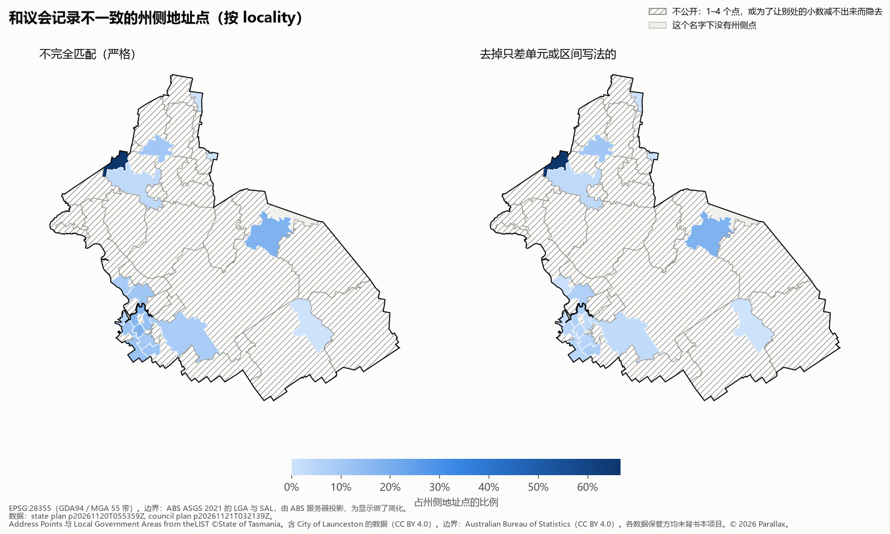
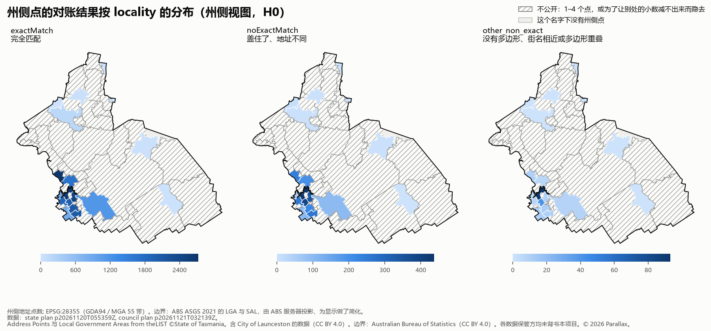

# 对账报告：州侧地址点与 City of Launceston 物业地址

> **公开版。** 只从过了发布闸门（`src/publish.py`，规则 G1–G7）的表生成。"<5" 表示 1–4；"n.p." 表示不公开：不管它是多少（0、1–4 或更大）都不写出来，免得用减法算出小数。这里不出现任何一侧的任何一条记录。
> 这是英文版的简体中文译本，以英文版为准。
> 数据：州侧 LIST Address Points（抽取计划 `p20261120T055359Z`），City of Launceston `Address`（计划 `p20261121T032139Z`）。运行 `S3-reconcile-2026-11-22-20261122T044936Z.json`。

## 摘要

- Launceston 辖区内有 **36,578** 个州侧地址点，议会发布了 **33,969** 个物业多边形。
- **32,358** 个点（88.46%）和盖住它的议会多边形完全匹配：门牌、单元、街名、locality 都相同。
- **4,220** 个点（11.54%）不完全匹配。其中 **2,620** 个被议会多边形盖住、和它只差单元或区间的写法（`noExactMatch`）；去掉这些，还剩 **1,600** 个（4.37%）。
- **1,279** 个点落在两个以上互相重叠的议会多边形里。
- 物业编号连不起两边：**32,358** 对完全匹配里，议会的 `Property_no` 和州侧的 `PID` 相等的只有 **0** 对。空间关系是唯一的锚点。
- 凡不是简单完全匹配的州侧点，以及没有对应或带标记（重叠、重复）的议会多边形，都进复核队列：**11,586** 条、**135** 类，每类用固定模板起草。没有用模型；人按类认可还在进行中。

## 范围

比对框是 Launceston 辖区。州侧点取 S1 判在辖区内或边界上的点（州侧第 28 层），坐标用 S2 按文档基准（GDA94，H0）转到 EPSG:28355 的结果。议会的多边形全部用。多边形 **covers** 一个点（在内部或正好在边上）就算落在里面：是或否的判断，没有容差、不用缓冲、不找最近的。

## 方法

阶段照 G-NAF 的处理说明（六步）：用四步、两步不适用、加一步：

| G-NAF 的阶段 | 本项目 |
|---|---|
| 1 Address scrubbing | 用：大小写、空白、空值；门牌拆成五栏；议会街名用州侧自己的词表拆 |
| 2 State-Locality validation and geocoding | 用前半（比 locality）；geocoding 不适用——两边本来就有几何 |
| 3 Street validation | 用：街名、类型、后缀分开比；只有这里允许模糊 |
| 4 Street geocoding | 不适用 |
| 5 Address geocoding | 不适用 |
| 6 Merging (criteria, confidence) | 用：七分类与置信度 |
| (no separate G-NAF stage) | 本项目加的：门牌校验，五栏，带两条写法差异规则 |

七分类照 `vicmap2osm` 的判定顺序，去掉它的导入方向：每一类对两边都适用。有两类是本项目自己加的，下表标明。完全匹配要门牌（五栏，含单元、区间）、街名（街名、类型、后缀）、locality 都相同。街名近似照 `vicmap2osm` 的规则（整个街名串的 lcs 相似度大于 0.8，来自 `string-comparison` 包），另加本项目只会收紧的条件：类型和后缀相同；近似永远不算匹配。

## 七分类

州侧点按自己这一侧归类；议会多边形按它参与的（点, 这个多边形）配对归类。两个视图都用 H0。

| 分类 | 州侧点 | 议会多边形 | 出处 | "两边都可能是错的"在这里是什么意思 |
|---|---:|---:|---|---|
| `outsideScope` | 268,999 | 0 | 出处：本项目加的（比对框） | 不比，只计数。辖区边界本身来自州侧第 28 层；边界错了，这一类的划分就错。 |
| `noCounterpart` | 99 | 424 | 出处：`vicmap2osm` 的 `notFoundInBlocks` 与 `noOSMAddressWithinBlock`，去方向后合成一类 | 可能州侧多了一个点、议会漏了一个物业，也可能州侧的点或议会的多边形放错了位置。 |
| `exactMatch` | 32,358 | 32,363 | 出处：`vicmap2osm` 的 `exactMatch`（单元号也要相同） | 两边一致。但两边的几何像是出自同一套地籍，一致不等于两边的位置都对。 |
| `fuzzyStreetMatchSingle` | 40 | 40 | 出处：`vicmap2osm` 的 `fuzzyStreetMatchesSingle` | 可能是拼写差异，也可能是两条不同的街；哪边拼错了不知道。 |
| `fuzzyStreetMatchMultiple` | 0 | 0 | 出处：`vicmap2osm` 的 `fuzzyStreetMatchesMultiple` | 同上，加上多边形重叠或共边。 |
| `withinOverlappingPolygons` | 107 | 0 | 出处：本项目加的（`vicmap2osm` 的 `withinExistingOSMAddressPoly` 在这里没有对应） | 可能议会有意让多边形重叠（同一块地上几个物业），也可能是画错；州侧点也可能放错。 |
| `noExactMatch` | 3,974 | 1,142 | 出处：`vicmap2osm` 的 `noExactMatch`；原因代码里的两种写法差异是本项目的规则 | 两边都可能错：门牌可能是一边写错，也可能是点放进了隔壁的多边形。只差写法的，多半两边都没错。 |

`fuzzyStreetMatchMultiple` 在本数据里是 0 条，举不出真实例子；它怎么判见测试夹具。

## 为什么不完全匹配

一个点可以有多个原因。计数是辖区内的州侧点（H0），包括所有带原因代码的分类（`noExactMatch` 和 `withinOverlappingPolygons`）；上面"只差写法"的数只数 `noExactMatch`。

| 原因代码 | 点数 |
|---|---:|
| `unit_representation`: 一边有单元号、另一边没有 | 2,319 |
| `range_representation`: 一边是区间、另一边是落在区间里的同单双单号 | 623 |
| `number`: 门牌号不同 | 1,194 |
| `number_missing`: 议会记录没有门牌号 | 0 |
| `number_unparsed`: 议会门牌号拆不开（没有猜） | 9 |
| `street`: 街名不同 | 572 |
| `street_similar`: 街名相近，但还有别的不同 | 6 |
| `locality`: locality 不同 | 127 |
| `on_shared_edge`: 点在两个以上多边形的共边上 | 0 |

严格的不一致率：11.54%（36,578 个里 4,220 个）。去掉只差写法的：4.37%（1,600 个）。两个并列，免得把单元或区间的不同写法读成错误。

**84** 个点的完整地址在议会侧存在，但在一个没盖住它的多边形里：点或多边形可能放错地方的线索。

## 重叠与基准

- **1,279** 个点严格在两个以上议会多边形的内部（不管归哪一类都带 `overlap` 标记；S2 得到的是同一个数）。
- **0** 个点只是落在边上。
- 换成 GDA2020（H1），**95** 个点换了分类（只在辖区一级报）。

## 重复与写法差异

照 `vicmap2osm` 的三种去重分工，但在每一侧内部做，不合并、不移动、不删除任何记录：

| 类型 | 州侧：组 | 州侧：条 | 议会：组 | 议会：条 |
|---|---:|---:|---:|---:|
| 整个地址相同 | 106 | 219 | 104 | 247 |
| 基本地址相同、只差单元 | 251 | 905 | 1,414 | 5,312 |
| 区间和落在区间里的单号 | 66 | 159 | 41 | 88 |

两条写法差异规则是本项目自己的，不算完全匹配：`unit_representation` 2,319 个点，`range_representation` 623 个点。

## 置信度

G-NAF 的置信度 = 提供这个地址的来源数 − 1；两个来源时，1 = 两边都有，0 = 只有一边有。它只看文字、在辖区内不管位置，和空间分类是两个独立的量。完整键含单元与区间，基本键去掉它们。

| 分类 | 完整 0 · 基本 0 | 完整 0 · 基本 1 | 完整 1 · 基本 0 | 完整 1 · 基本 1 |
|---|---:|---:|---:|---:|
| `noCounterpart` | 35 | 57 | 0 | 7 |
| `exactMatch` | 0 | 0 | 0 | 32,358 |
| `fuzzyStreetMatchSingle` | 40 | 0 | 0 | 0 |
| `fuzzyStreetMatchMultiple` | 0 | 0 | 0 | 0 |
| `withinOverlappingPolygons` | 42 | 56 | 0 | 9 |
| `noExactMatch` | 1,281 | 2,625 | 0 | 68 |

置信度为 1 的州侧点：32,442（完整键）、35,180（基本键）。议会多边形：32,455 和 33,112。

## 按 locality

按州侧自己的 `LOCALITY` 栏分组（不做空间连接），只数辖区内。49 个 locality 里有 32 个不公开：它们至少有一个计数（或能从它们算出来的计数）是 1–4，或者为了让这样的行不能用辖区合计减出来而一起隐去。

| Locality | 点数 | 不完全匹配 | 比例 | 去掉只差写法 | 比例 |
|---|---:|---:|---:|---:|---:|
| BANGOR | n.p. | n.p. | n.p. | n.p. | n.p. |
| BLESSINGTON | n.p. | n.p. | n.p. | n.p. | n.p. |
| BURNS CREEK | 12 | 0 | 0.00% | 0 | 0.00% |
| DILSTON | n.p. | n.p. | n.p. | n.p. | n.p. |
| EAST LAUNCESTON | n.p. | n.p. | n.p. | n.p. | n.p. |
| GOLCONDA | 8 | 0 | 0.00% | 0 | 0.00% |
| INVERMAY | n.p. | n.p. | n.p. | n.p. | n.p. |
| KAROOLA | 171 | 6 | 3.51% | 6 | 3.51% |
| KINGS MEADOWS | 2,318 | 229 | 9.88% | 115 | 4.96% |
| LALLA | n.p. | n.p. | n.p. | n.p. | n.p. |
| LAUNCESTON | 3,165 | 530 | 16.75% | 231 | 7.30% |
| LEBRINA | n.p. | n.p. | n.p. | n.p. | n.p. |
| LILYDALE | n.p. | n.p. | n.p. | n.p. | n.p. |
| LOWER TURNERS MARSH | 15 | 10 | 66.67% | 10 | 66.67% |
| MAYFIELD | n.p. | n.p. | n.p. | n.p. | n.p. |
| MOUNT DIRECTION | n.p. | n.p. | n.p. | n.p. | n.p. |
| MOWBRAY | 1,887 | 205 | 10.86% | 128 | 6.78% |
| MYRTLE BANK | n.p. | n.p. | n.p. | n.p. | n.p. |
| NEWNHAM | 2,971 | 250 | 8.41% | 38 | 1.28% |
| NEWSTEAD | 2,850 | 358 | 12.56% | 90 | 3.16% |
| NORTH LILYDALE | n.p. | n.p. | n.p. | n.p. | n.p. |
| NORWOOD | n.p. | n.p. | n.p. | n.p. | n.p. |
| NUNAMARA | n.p. | n.p. | n.p. | n.p. | n.p. |
| PATERSONIA | n.p. | n.p. | n.p. | n.p. | n.p. |
| PIPERS BROOK | n.p. | n.p. | n.p. | n.p. | n.p. |
| PIPERS RIVER | n.p. | n.p. | n.p. | n.p. | n.p. |
| PROSPECT | 971 | 114 | 11.74% | 44 | 4.53% |
| PUNCHBOWL | n.p. | n.p. | n.p. | n.p. | n.p. |
| RAVENSWOOD | n.p. | n.p. | n.p. | n.p. | n.p. |
| RELBIA | n.p. | n.p. | n.p. | n.p. | n.p. |
| RETREAT | n.p. | n.p. | n.p. | n.p. | n.p. |
| ROCHERLEA | n.p. | n.p. | n.p. | n.p. | n.p. |
| SOUTH LAUNCESTON | 2,449 | 434 | 17.72% | 127 | 5.19% |
| ST LEONARDS | 1,253 | 107 | 8.54% | 40 | 3.19% |
| SUMMERHILL | n.p. | n.p. | n.p. | n.p. | n.p. |
| SWAN BAY | n.p. | n.p. | n.p. | n.p. | n.p. |
| TARGA | 33 | 6 | 18.18% | 6 | 18.18% |
| TAYENE | n.p. | n.p. | n.p. | n.p. | n.p. |
| TREVALLYN | 927 | 55 | 5.93% | 16 | 1.73% |
| TUNNEL | 49 | 5 | 10.20% | 5 | 10.20% |
| TURNERS MARSH | n.p. | n.p. | n.p. | n.p. | n.p. |
| UNDERWOOD | n.p. | n.p. | n.p. | n.p. | n.p. |
| UPPER BLESSINGTON | n.p. | n.p. | n.p. | n.p. | n.p. |
| WAVERLEY | n.p. | n.p. | n.p. | n.p. | n.p. |
| WEST LAUNCESTON | 2,146 | 260 | 12.12% | 110 | 5.13% |
| WHITE HILLS | n.p. | n.p. | n.p. | n.p. | n.p. |
| WINDERMERE | n.p. | n.p. | n.p. | n.p. | n.p. |
| WYENA | n.p. | n.p. | n.p. | n.p. | n.p. |
| YOUNGTOWN | 2,339 | 269 | 11.50% | 187 | 7.99% |

## 地图

由 `src/maps.py` 画，坐标系 EPSG:28355。公开版只在 ABS ASGS 2021 的边界上画聚合，不画任何州侧点。

## 复核队列

11,586 条、135 类。一类 = 哪一侧 + 分类 + 原因代码 + 标记；同一类的每一条都由同一个固定模板起草处置。人看过固定种子抽出的最多 10 条后，按类认可或改写（所有类合计要看 699 条）。

起草的处置有：缺陷候选（哪一边对不知道）；由人判断是不是同一条街；地址一致；议会多边形重叠，由人判断是不是有意的；一侧内部的重复，只计数；写法不同，多半不是缺陷；只是信息。按处置、按类的条数只在内部版：和分类的合计放在一起公开，有几个能减出小数。

## 不用模型

计划书允许在确定性规则之后的残差大到人压不住时，训练一个小的排序模型。设计预计用不着：残差能按类分开，每类都能用确定性模板起草。这要等人把各类批完才算确认；如果某一类抽查的条目里改写超过一半，再回来重议。

## 我可能错在哪

- 两边的几何像是出自同一套地籍（S2：州侧"地块质心"点和它所在议会多边形的质心，逐对偏移的中位数是 0.5 毫米），一致不是两次独立测量互相印证。地址文字是不是从一边拷到另一边，没有检验。
- 基准按保管方文档取 GDA94（H0）。换成 GDA2020（H1），有 95 个点换了分类。
- 州侧放置类型 `Urban Centroid` 的含义没有在保管方文档里核实。
- 辖区边界来自州侧第 28 层。地图上画的是 ABS 的 LGA 边界，和第 28 层可能不完全一样。
- 比对单位是议会的物业多边形，比 `vicmap2osm` 的城市街区细。
- 模糊阈值（整个街名串的 lcs > 0.8）借自维州的先例，没有在本数据上校准。
- 清洗很浅：不纠拼写、不展开缩写；议会门牌靠正则拆，议会街名靠州侧词表拆。
- 区间写法差异的规则（落在区间里、同单双）是本项目自定的，没有保管方文档。
- 邮编不比。
- 两边各只取了一次快照。S2 之后州侧源又多了 10 个点（都在辖区外）。
- 复核队列是按类批、每类抽查最多 10 条，不是逐条细看。

## 署名

- Address Points from theLIST ©State of Tasmania; Local Government Areas from theLIST ©State of Tasmania.
- Contains data from City of Launceston, licensed under CC BY 4.0 (https://creativecommons.org/licenses/by/4.0/).
- Map boundaries: Australian Bureau of Statistics, ASGS Edition 3 (2021), CC BY 4.0.
- 各数据保管方均未背书本项目。

---

© 2026 Parallax，保留所有权利。
